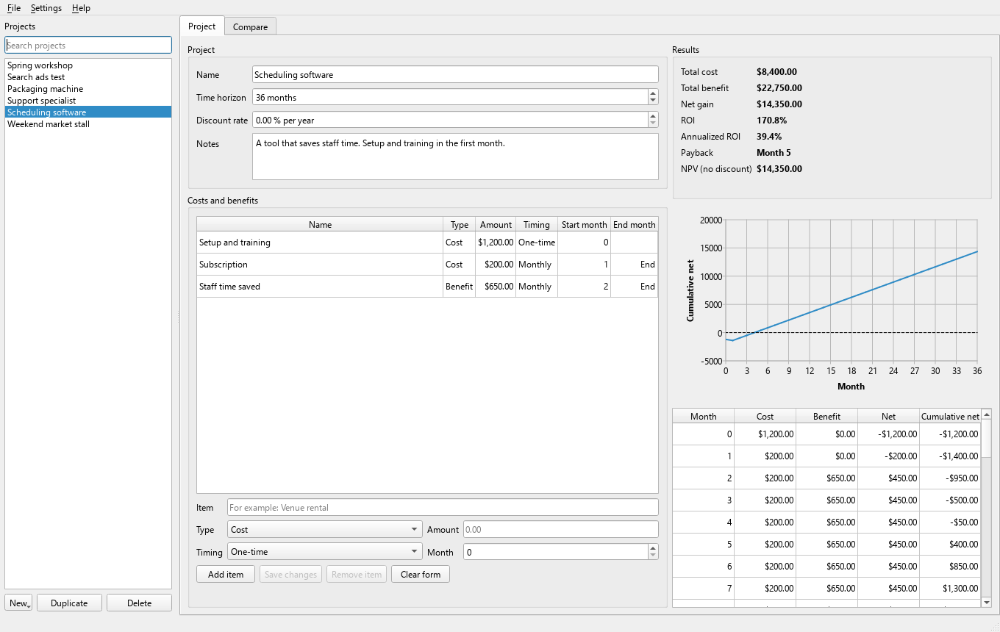

# ROI Calculator

A small desktop app that tells you whether an investment pays off: what it costs, what it brings in, the ROI, and when you get your money back.
It is for anyone weighing a decision: an event, an ad campaign, a machine, a new hire, a software tool, or a side project.



## Features

- Any number of projects, each with a name, notes, a time horizon in months, and an optional discount rate.
- Costs and benefits as line items: one-time (in a chosen month) or monthly (from a start month to an end month).
- Results update as you type: total cost, total benefit, net gain, ROI, annualized ROI, payback month, and NPV.
- A month by month table and a chart of the running total.
- Compare view: every project side by side, sortable by any column.
- Templates to start from: Event, Marketing campaign, Equipment purchase, New hire, Software subscription, Blank.
- Load sample data to see how it works.
- Search projects by name, notes, or line item.
- CSV export of a project (line items, results, monthly table) or of the comparison. CSV import of line items.
- Exports open cleanly in Excel (UTF-8 with BOM) and text that looks like a formula is neutralized.
- Choose your own currency symbol.
- Readable in light and dark mode. Scrolls on small screens.
- Works fully offline. No network access, no accounts, no telemetry.

## Install and run

You need Python 3.10 or newer.

**Windows (PowerShell)**

```powershell
python -m venv .venv
.\.venv\Scripts\Activate.ps1
pip install -r requirements.txt
python -m app.main
```

**macOS and Linux**

```bash
python3 -m venv .venv
source .venv/bin/activate
pip install -r requirements.txt
python -m app.main
```

On Linux, Qt may need a few system libraries. On Debian or Ubuntu:

```bash
sudo apt-get install libegl1 libxkbcommon-x11-0 libxcb-cursor0
```

## Using it

1. Click **New** and pick a template, or use **File > Load sample data**.
2. Set the time horizon. Month 0 is the start.
3. Add costs and benefits. Pick **One-time** for something that happens once, or **Monthly** for something that repeats. A monthly item with an end month of "End of horizon" runs to the end.
4. Read the results on the right. Use the **Compare** tab to see all projects together.

A blank amount is saved as 0, and the app tells you so. Amounts like `1,250.50`, `$ 900` or `1.250,50` are understood.

## Where your data is stored

Projects are saved automatically to a single file, `projects.json`, in your user app data folder:

| System  | Folder |
|---------|--------|
| Windows | `%APPDATA%\ROI Calculator` |
| macOS   | `~/Library/Application Support/ROI Calculator` |
| Linux   | `~/.local/share/ROI Calculator` |

**File > Open data folder** opens it. The data never lives next to the program, so the app also works when installed in a read-only place such as Program Files.

Saving is safe: the app writes a temporary file and then swaps it in, and keeps the previous version as `projects.json.bak`. If `projects.json` is ever damaged, the app does not overwrite it. It renames it to `projects.damaged-<date>.json`, tells you, and starts with an empty list.

Exports and imports start in your Documents folder.

## How the numbers are calculated

The timeline runs from month 0 (the start) to month N, where N is the time horizon. Only amounts inside that window count.

- **Total cost** = the sum of every cost in months 0 to N.
- **Total benefit** = the sum of every benefit in months 0 to N.
- **Net gain** = total benefit minus total cost.
- **ROI** = net gain / total cost x 100. If total cost is 0, ROI is shown as N/A.
- **Payback month** = the first month from which the running total of (benefits minus costs) is zero or above and stays there until month N. If that never happens, it shows "Not within horizon".
- **Annualized ROI** = ((total benefit / total cost) ^ (12 / N) minus 1) x 100. It turns the result into a yearly rate, so projects of different lengths can be compared.
- **NPV** (net present value) = the sum over every month m of net(m) / (1 + r) ^ m, where r = (1 + yearly discount rate) ^ (1/12) minus 1. With a discount rate of 0, NPV equals net gain.

Example: a 1,000 cost in month 0 and a 300 benefit every month from month 1 gives a running total of -1,000, -700, -400, -100, 200. Payback is month 4.

## CSV import format

The first row must be a header. Only **Name** and **Amount** are required.

```csv
Name,Type,Amount,Timing,Start month,End month
Venue rental,Cost,2000,One-time,0,
Ticket sales,Benefit,3000,One-time,1,
Monthly membership fees,Benefit,250,Monthly,2,6
```

- Type: `Cost` or `Benefit` (blank means Cost, with a note).
- Timing: `One-time` or `Monthly` (blank means One-time).
- Start month: blank means 0 for one-time items and 1 for monthly items.
- End month: blank means the end of the horizon.
- Reading stops at the first empty row, so a file exported from the app can be imported as is.
- Rows that cannot be read are skipped and listed after the import.

## Running the tests

```bash
pip install -r requirements-dev.txt
pytest
ruff check .
```

The Qt tests run without a window (`QT_QPA_PLATFORM=offscreen`). GitHub Actions runs the same tests on Windows and Ubuntu for every push and pull request.

To refresh the screenshot: `python scripts/make_screenshot.py`.

## Building the Windows EXE

```powershell
.\build_exe.ps1
```

or by hand:

```powershell
pip install -r requirements-dev.txt
python -m PyInstaller --noconfirm --clean ROICalculator.spec
```

The app ends up in `dist\ROICalculator\ROICalculator.exe`. Copy the whole `dist\ROICalculator` folder wherever you like, including Program Files.

## Project layout

- `app/models/project.py`: data classes for projects and line items
- `app/services/calculator.py`: all the math (pure functions, no Qt)
- `app/services/storage.py`: safe JSON saving and loading
- `app/services/csv_io.py`: CSV export and import
- `app/services/templates.py`: templates and sample data
- `app/ui/`: the Qt windows and widgets
- `tests/`: automated tests

## Contributing

See [CONTRIBUTING.md](CONTRIBUTING.md).

## License

ROI Calculator is free and source available under the AmadOpenSource License 1.0. See [LICENSE](LICENSE) for the full terms.

- You may use it for anything, including in your business and to make money, and your results are yours.
- You may not sell the software itself, charge others to use or host it, or turn it into a paid or closed product.
- Free changed versions are welcome if they keep this license and publish their full source code.

Versions based on this project must show the credit line "Based on ROI Calculator by Joshua Amado".
